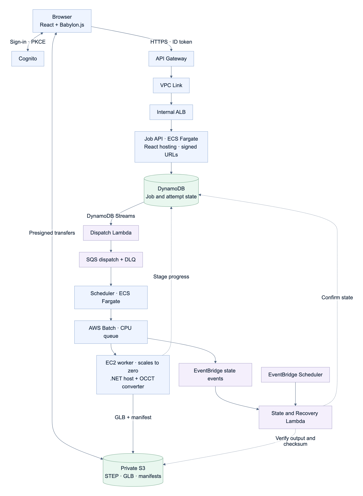

# STEP → GLB distributed CAD platform

A React and Babylon.js workspace uploads STEP models and previews GLB results. A .NET 10 API manages tenant-scoped jobs, and AWS Batch runs the C++20 converter with OpenCascade 7.9.3 on EC2. CloudFormation provisions the AWS platform.

The local and AWS workflows have both been tested with real STEP models. See [validation results](docs/validation.md).

## Architecture

[](docs/architecture.png)

Amazon ECR stores the runtime images. CloudWatch collects service logs and raises operational alarms. See [architecture details](docs/architecture.md) for the service boundaries and the local development path.

## Run a real conversion

Requirements: .NET SDK 10, Node 24 LTS, CMake ≥3.24, Ninja, C++20 compiler, OCCT **7.9.3**. On macOS:

```sh
brew install cmake ninja opencascade node@24
export PATH="$(brew --prefix node@24)/bin:$PATH"
bash scripts/build-native.sh -DCMAKE_PREFIX_PATH="$(brew --prefix)"
build/native/step-to-glb --input build/native/fixtures/assembly.step --output artifacts/assembly.glb
```

CMake rejects other OCCT versions. The worker Dockerfile builds the pinned source commit when system packages are unsuitable. Generated fixtures include a named red box and an assembly with two transformed instances.

```sh
bash scripts/run-local.sh
```

Open **http://127.0.0.1:5173** and upload `build/native/fixtures/assembly.step`. The API listens at `http://127.0.0.1:5080`. Local mode uses a fixed development tenant, signed filesystem transfer URLs, disk-backed conditional writes, and a separate C# worker process. It is restricted to the Development environment. It does not emulate Batch, S3, DynamoDB, Cognito or AWS event delivery.

With the API running, a second terminal can run:

```sh
python3 scripts/smoke.py --timeout 120
```

The result is a real GLB at `artifacts/smoke.glb`. Upload progress measures transferred bytes; OCCT stages without measurable subprogress stay indeterminate. Only verified output plus confirmed provider success produces 100%.

## Validate

```sh
python3 -m venv .local/python
.local/python/bin/pip install -r scripts/requirements.txt
bash scripts/check.sh -DCMAKE_PREFIX_PATH="$(brew --prefix)"
# With API and UI running:
npm exec --prefix src/frontend -- playwright install chromium
node tests/frontend/browser-smoke.mjs
```

`check.sh` runs native tests, locked .NET restore/build/tests, frontend tests, Khronos validation + Babylon import checks, production TypeScript/Vite build, and CloudFormation lint. Linux users can omit the Homebrew prefix. Tests require the native fixtures generated by CTest; the script orders them accordingly.

## Deploy to AWS

Docker with buildx and working AWS credentials are required. This provisions billable resources:

```sh
dotnet run --project tools/Deploy -- --region eu-west-1 --environment cad-demo
```

The script deploys ECR/artifact bootstrap first, builds and pushes **linux/amd64** runtime images, packages C# Lambdas, and deploys networking and the platform. The Job API image includes the compiled React app and serves it through API Gateway. Every infrastructure resource comes from CloudFormation. It does not run a conversion smoke test automatically: provision tenant accounts, sign in, and run the [AWS smoke procedure](docs/deployment.md).

## Layout and documentation

- `src/hpc/StepToGlb`: AWS-independent C++20 converter and real fixture tests.
- `src/backend/{Domain,Application,Infrastructure}`: state machine, use cases, AWS/local adapters, dispatch/recovery and worker execution.
- `src/backend/{JobApi,Scheduler,DispatchLambda,StateRecoveryLambda,WorkerHost}`: deployable .NET applications.
- `src/frontend`: React/TypeScript upload workspace and Babylon.js viewer.
- `infrastructure/cloudformation/{bootstrap,network,platform}.yaml`: complete infrastructure composition.
- `docker`, `scripts`, `tests`: images, deployment/local automation and verification.

Read [architecture](docs/architecture.md), [API](docs/api.md), [data model](docs/data-model.md), [security](docs/security.md), [reliability](docs/reliability.md), [deployment](docs/deployment.md), [cost guidance](docs/cost-estimation.md), [geometry](docs/geometry.md), and [assumptions](docs/assumptions.md). The original task is preserved in [SPEC.md](docs/SPEC.md).
